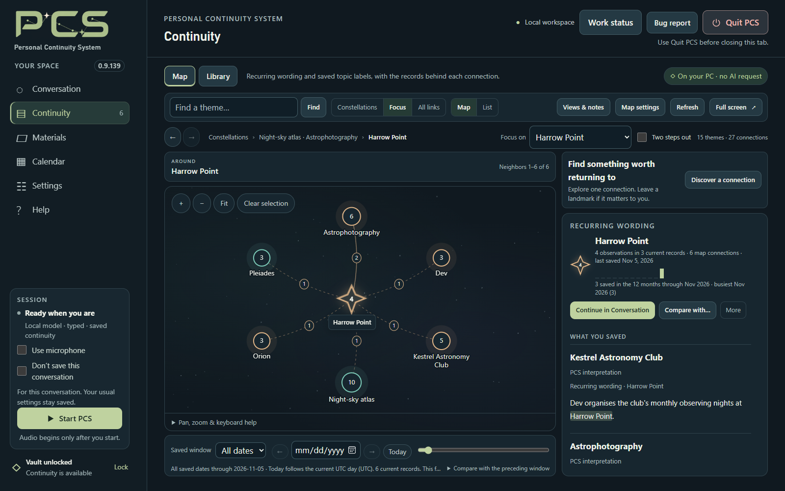

# PCS - Your personal thinking space

**Room to think. Space to connect.**

Some thoughts need more than one conversation. PCS brings AI conversation, revisable memory, reading, notes and planning into a workspace you own. Bring an unfinished question, a difficult passage or an idea. Work on it, keep where you stopped, and return with a place to begin.

**Change the AI. Keep your continuity.** Choose a supported Local, Google, OpenAI, Meta, Claude, signed-in ChatGPT or OpenRouter connection. Your saved conversations, memories and notebooks stay in PCS when you change connections. Each model brings its own abilities; your workspace belongs to you.

**[Download for Windows][windows]** · [What's new][release] · [Website][website] · [Discord][discord] · [Report a bug][issues]

**Other platforms:** [Older experimental Linux x64][linux-experimental] · [Older experimental macOS for Apple silicon][mac-experimental] · [Archived platform downloads][older-platforms]

> **PCS 0.9.180 · Windows x64 · Under active development**
>
> Free and open source, with no PCS subscription or paid feature tiers. Provider API charges and any subscription used for ChatGPT sign-in are separate. Local models, AI runtimes and optional speech packs are separate downloads.

*One place, several ways back in. The Continuity Map as it looked in PCS 0.9.139, with fictional demonstration records in the Local memory format; not a live AI conversation. Harrow Point links three saved subjects because it is named in observations from each. The Map has been redesigned since; see [below](#follow-a-connection-back-to-your-own-words).*

## A place to work through things

| When you want to… | PCS gives you… |
| --- | --- |
| Start somewhere easy | **Get acquainted**, a relaxed first conversation that PCS begins, with nothing to fill in. |
| Think something through | Typed or spoken conversation, editable Companion direction and a choice of conversation pace. |
| Pick up an unfinished thought | An encrypted shelf of stopping points, next steps and pins, plus an editable draft when you return. |
| Understand what was remembered | Saved conversations and revisable memories, with original passages, corrections, sharing controls and deletion together with the conversation a memory came from. |
| Follow how an idea changed | Links between exact memory revisions, settled marks and named lessons with supporting stories. |
| Find an unexpected connection | A Continuity Map of saved themes and the people, places and projects in them, brighter where you have added lately, with the records behind each connection and space for your own notes. |
| See how PCS's own view develops | Optional PCS Perspective tracks PCS's interests, reflections and open questions separately from your continuity, shows where its thoughts rest on your memories and makes them available for inspection. |
| Read and learn | Materials readers, bookmarks, Read Along, Prepared notes, Reference notes, notebooks and Practice. |
| Find your work and plan ahead | A searchable Library and Calendar tasks, goals and events. |

Manual reading, notes, Calendar entries and saved-record browsing work without starting an AI conversation.

## Get started

### Windows

1. Download **[PCS-0.9.180-Windows-x64.zip][windows]** (42 MB) and extract the complete ZIP into a fresh writable folder.
2. Open **Start PCS.exe**. First launch prepares the bundled Python environment offline.
3. Choose **Get started**. Quick setup walks through **Workspace, Connection, Sharing, Voice, Screen and Review**. Keep your vault passphrase safe. If you're moving an existing vault, follow the [upgrade steps below](#upgrading-and-backups).
4. Choose a connection, then review **Recommended continuity** or **Conversation only** and what you want to save and share. OpenRouter is included in Quick setup: enter its key, load the public catalogue and choose an exact model with tool support. **Free models only** and **Image-capable models only** filter the list without changing your choice. Quick setup also saves the recommended OpenRouter memory model, `anthropic/claude-haiku-5.5`, when none is set. Claude uses its Console API key; with Recommended continuity a new Claude setup uses Haiku 5.5 for memory and keeps your chosen model for conversation. For ChatGPT, finish Quick setup, sign in once, then choose **Get ChatGPT ready** under **Start PCS** or in **Settings → Connections**: it finds the saved account and loads its models in one click. Local setup guides you to its model and runtime files. Review your choices, including any optional Voice and Screen setup, then choose **Finish setup**.
5. Choose **Get acquainted →** for a first conversation that PCS begins, or type a message and choose **Start & send**. The optional **Voice** step guides local listening and speech for Meta, Claude, ChatGPT, OpenRouter and Local AI; a spoken turn can run to 60 seconds and ends after 1.5 seconds of silence. Use **Screen** to connect OBS Studio and choose the scene PCS may see. OpenRouter Vision needs an image-capable model; Finish checks the selected model's advertised tool/image support without generating a reply.
6. At a useful stopping point, choose **Keep a stopping point** and review what you want to retain.

The welcome screen matches where you are: **Get started** for a new workspace, **Nice to meet you.** once your vault is open and nothing is saved yet, and **Pick up where you left off.** when saved memories exist. Not ready to set up? **See an example** shows a fictional stopping point without adding anything to your vault.

The download includes getting-started and restore guides, plus searchable offline Help. A Settings task finder helps you locate controls. Keep the application files together: the launcher checks the package manifest. To check an installation, `support\start.ps1 -Verify` checks the package, installed dependencies and core imports offline. Use **Quit PCS** when finished; closing the browser tab alone can leave the application running.

### Older Linux and Mac experiments

Experimental builds are available on the **[previous release page, tagged 0.9.114][older-platforms]**:

| Platform | Download |
| --- | --- |
| **Linux x64** | [PCS 0.9.115 - experimental build][linux-experimental] (`.tar.gz`) |
| **macOS - Apple silicon (arm64)** | [PCS 0.9.114 - Experimental 1][mac-experimental] (`.zip`) |

These are archived experiments, not 0.9.180 ports. They do not include the current Windows features or its verification. Follow their own bundled platform instructions. Matching source archives are on the same [release page][older-platforms].

## Bring one unfinished thing

Start with a question, decision, passage or idea that matters to you. For example: *“I keep collecting ideas for this project. Help me choose one small thing to try next.”*

Choose **Follow my lead**, **Think with me** or **Take the lead**. Think with me is guided to develop one manageable thought at a time and leave room for your response. **Quiet for now** and **Stay here** pause topic planning until you explicitly resume. **How often PCS offers new angles** and **Conversation pace** separately control initiative.

PCS has a built-in character of its own: it has opinions, tastes and dry humor, says "I think" plainly, and answers "what are you" in a sentence rather than a lecture. It never invents events or a human life story. The default **Companion direction** favors calm, self-possessed replies, proportionate praise and fewer routine follow-up questions. Companion directions you wrote yourself are kept.

If you'd rather start gently, **Get acquainted** is a relaxed conversation of about ten minutes that PCS begins. Skip anything or change the subject whenever you like. It is an ordinary saving conversation under your memory and sharing settings, so you can inspect and correct what was kept. **Tell PCS more about you** runs it again later.

### Leave a stopping point

Keep a title, where you stopped and an optional next step. Review the note before saving it to your encrypted shelf. Pin it, edit it, mark it resolved, reopen it or delete it when you choose.

On a later visit, unlock your vault. **Where you left off** shows saved threads, open notes, your reading desk and upcoming Calendar plans without a model request. Review the suggested stopping point and its sources, then choose **Review & continue** to prepare an editable draft. You decide whether to send it, and existing unsent text is protected. When you come back, PCS can also greet you with something to pick up; that greeting is not saved as something it learned about you.

A resumed thought stays available across Conversation, Materials, Continuity and Calendar. **Explore in Map** carries it into the Map as a temporary reminder.

## Follow a connection back to your own words

The **Continuity Map** opens on **All links**: every displayed theme at once, grouped into constellations, with each constellation's strongest links drawn until you choose a theme. Themes are brighter the more recently you added to them. **Saved lately**, **Gone quiet** and **Strongest links** highlight part of the map, and **Told at Start** shows what a conversation's startup notes would name now. Follow a theme into **Focus**, open **Constellations**, or use **List**. The trail above the Map lets you revisit earlier steps.

- **Open the evidence.** Select a connection to inspect the saved records behind it in one panel.
- **Compare two themes.** **Compare with…** shows a route through shared records and themes.
- **Keep what matters.** Add a connection note, leave a landmark in your own words, or choose **Continue in Conversation**.
- **See where PCS has been thinking.** Where PCS Perspective holds thoughts built on one of your memories, that theme is marked and lists **PCS's thoughts resting here**.
- **Explore at your own pace.** Try **Discover a connection**, or browse freely. Filters and coverage are under **Map settings**; saved views and connection notes are under **Views & notes**.

Themes come from **saved labels and repeated wording** by default, preserving phrases such as “Bread making.” **Saved labels only** is available under **Map settings**. Local memory keeps one account per subject and adds later observations to it, so the Map counts each current observation: a subject you return to often appears larger, and the people, places and projects named in it become linked themes. A name that appears under two subjects connects them.

The Map runs on your PC without calling a model. A line means two themes occur in the same saved record or observation. It does not establish agreement, cause or a personality trait. Open the evidence and decide what the connection means to you. Names are recognised by their capital letters, so a name written in lowercase is missed.

The Map reads up to **50,000 memories** and shows up to **1,000 themes** and **10,000 connections**. The encrypted index follows saves, corrections and forgetting.

At Start, cloud connections are told more of your map: up to 24 saved areas plus further themes by name, and one line per thread of PCS's own thinking. On a generated test vault with 400 unrelated memories added, that summary led to the right memory for 16 of 16 test questions, against 11 of 16 before.

## Memory you can inspect and revise

Saving conversation text and allowing memory formation are separate choices. With learning enabled, PCS can create model-written accounts linked to original passages. Inspect the evidence, review earlier wording, correct an account in ordinary language or choose **Forget**. Your words, your corrections and model interpretations remain distinguishable.

On cloud connections, PCS checks where each new thing you said was filed, so a new subject gets a memory of its own instead of being added to an unrelated one. An automatic update can no longer cut a memory down to a fraction of what it held; if the model tries, the memory is left as it stands. **Stop** gives cloud memory one short last pass, up to 20 seconds, so what you said just before stopping is not left for next time. Local AI keeps its own memory checks.

Memory jobs are harder to derail. A memory the review accepted is saved even when the summary written with it is rejected. A stretch of small talk no longer erases the summary PCS starts the next conversation with. When a batch of conversation is too much for the memory model in one go, PCS tries again with half as much, and a batch that fails for a reason of its own is set aside so that newer conversation is still learned. A save waits briefly for a reply that is being written, so the reply is not lost.

Deleting a memory offers **Also delete the conversation this came from**. It shows how much will be removed, warns when the memory draws on more than one conversation, and keeps anything another memory still uses.

When you ask PCS to remember something, the request gets its own check, and the result card shows whether the save was confirmed, did not succeed or left a record unchanged. Correction screens show that saving your wording and rebuilding semantic search are separate steps; saved corrections keep their history and current status.

Recall follows your sharing permissions and keeps relevant corrections attached. It can bring back the original conversation passages behind a saved account, including the evidence for a correction. Recalled material labels which words were yours, which were the assistant's and which accounts you edited, so the model can tell them apart. Local checks whether a question needs saved context before replying. A blocked or failed lookup is distinguished from a completed search with no match. Memories and AI answers can still be incomplete or mistaken.

Open a memory and choose **Settled, links & lessons** to:

- Link memories to record how one idea developed from another.
- Mark an exact revision settled as your current word on its subject. A correction retires the mark until you review the new wording.
- Keep a named lesson with your story, takeaway and supporting memories.

Links and lessons retain the revisions you reviewed and identify changed or unavailable references. Forgetting a memory removes its revisions and updates dependent records.

**Memory can follow your conversation connection.** Google, OpenAI, Meta, Claude, signed-in ChatGPT, OpenRouter and Local support their permitted memory workflows within the selected model's capabilities. OpenRouter can use its own key and explicit model for learning, Remember requests, corrections and recall; another provider is not required. The recommended OpenRouter memory model is `anthropic/claude-haiku-5.5`, and **Settings** offers **Use recommended**. Optional helper choices remain explicit, and PCS does not automatically switch providers after a failure.

On Claude, memory can use its own model: **Settings → Connections → Memory**. New Claude setups with Recommended continuity use Haiku 5.5 for memory, which costs much less per request; existing setups keep what they have until you change it. This choice rests on one test with a made-up conversation and has not been tried on a real vault.

**Help notice relevant memories in conversation** is included in **Recommended continuity** and can be changed under **Settings → Memory & sharing**. It requires memory-sharing permission. Supported routes can use a compact overview or matching cues to help find saved context. A cue sent to a cloud provider shares that information; hints do not guarantee a relevant memory will be found.

### Memory that comes to mind (experimental)

Three settings change what the AI model is given from your saved memories. All three are off unless you turn them on, Quick setup does not turn them on, and each takes effect at the next Start.

- **Let memories come to mind on their own** (**Settings → Memory & sharing → Personal memory**). PCS looks on your PC for saved memories and earlier turns related to what you just said, and gives the model up to three. When nothing is clearly related, it gives nothing.
  - On Local AI, Meta, Claude, ChatGPT and OpenRouter this adds no AI request.
  - On OpenAI Realtime a match can go with the first spoken reply. A match that arrives late can lead to a follow-up, and **a follow-up or a short wait for one can cost an additional paid reply**.
  - On Google Live (paid personal-content connection) a match from the exchange you just finished is offered as you start speaking again, **before PCS knows your new topic**. If you change subject, Google may still receive the earlier detail; PCS asks it to leave the detail out.
- **Start with a fuller picture of what PCS knows** (same place). At each Start PCS builds a short picture from your saved memories: your name, up to five ongoing subjects and your last conversation. It is rebuilt every time, so a memory you corrected or deleted cannot stay in it.
- **Show what PCS has in mind** (**Settings → Conversation → Session**). The Memory stream panel lists what the model was given, by subject and size.

These settings match words, not meaning, and the model can still overlook or contradict a memory it was given. In a scripted spoken test on OpenAI Realtime, 2 of 4 cases were answered correctly. Treat them as experiments and tell us how they feel.

## PCS Perspective (optional)

PCS Perspective keeps PCS's developing interests, reflections and open questions separate from your own continuity, in the same encrypted vault. **Recommended continuity** enables it with independent interests for new vaults. Open **PCS Perspective** in Conversation to review its choices and records.

- Inspect wording, supporting references, uncertainty, model authorship and revision history, or explore its own Map, which shows each line of thinking as one row.
- Carry current perspectives and unfinished inquiries between supported models.
- Each background step thinks freely about the conversation first, then files what it concluded. PCS thinks on its own at most 12 times an hour on a cloud Preparation model and 30 times on Local, with the microphone on; what you say ends that step.
- A finished thought can be worked into PCS's next ordinary reply, on every supported connection including Google Live, or said at a quiet moment. PCS speaks up on its own at most four times an hour.
- Invite PCS to take its time (“think it over and come back to me”) and it thinks in the background with the microphone on, then says what it came to. **Explore now** still offers a focused pause with microphone input **off**; use **Return to conversation** to interrupt. PCS cannot hear a spoken interruption while the microphone is off.

Exploration uses the displayed Preparation model and can make extra requests: on a cloud Preparation model, each background step makes two. It does not independently browse the web or read Materials. Relevant perspectives may also reach your conversation model under the feature's sharing notice. The contributions are optional and bounded; PCS may have nothing useful to say, or may still choose an awkward moment.

Perspective records make model interpretations inspectable; they do not establish subjective experience.

## Read, discuss and learn

**Materials** supports readable PDFs, EPUBs, Office and OpenDocument files, tables, slides, subtitles, HTML and common text/code formats, with file-format tiles, reading-time estimates and highlighted passage search. Find a passage, keep a bookmark, listen through an available local voice, or review an excerpt before sharing it with your selected model.

Research and Practice start from Materials: Study research is under **Materials → Reference notes**, and the practice chooser is under **Materials → Notebooks**. **Research this question** sits under the message box, and the practice card appears in Conversation while a lesson is running.

**Prepared notes** support longer reading projects. **Prepare book** works through an explicitly approved sequence and saves checkpoints; **Resume** lets you review the next scope. Notebooks hold notes, goals, lessons and source references. Practice can retain submitted answers and assessments when enabled.

You can also attach or drop a UTF-8 `.txt` or `.md` file and review it before choosing **Use in this chat**, **Keep for later**, or **Save reviewed text in Materials**. A Materials copy is an ordinary file outside the encrypted vault; back it up separately. Scanned documents need OCR elsewhere, and some Web pages cannot be captured.

Reviewed quotations can be added to a Notebook, lesson or Calendar entry while preserving their wording and authorship. Keeping a thought or creating a Calendar entry does not schedule automatic follow-ups or reminder delivery.

Optional **Explore connections** in the Library lets you select records, add a question and review which excerpts may be shared with Jev. This trial requires a TypeSafe key and permission for each request. Its suggestions do not automatically create memories or change the Map.

## Choose where the AI runs

| Connection | Access and model choice | Listening and spoken replies |
| --- | --- | --- |
| **Local on this PC** | Compatible hardware, supported model and verified runtime. Recommended Gemma/CUDA needs a compatible NVIDIA GPU. | Optional local listening; Windows or Kokoro speech. |
| **Google API** | Google API key and a compatible Live model. Review the Personal/Public content profile for your project's terms. | Native provider audio on the supported connection. |
| **OpenAI API** | OpenAI API key and a compatible Realtime model. API billing is separate from ChatGPT subscriptions. | Native provider audio on the supported connection. |
| **Meta** | Meta API key and supported Standard model. | Optional local listening and speech. |
| **Claude API** | Anthropic Console API key and a compatible model. | Optional local listening and speech. |
| **ChatGPT sign-in** | Eligible signed-in account and an available model; no API key. **Get ChatGPT ready** prepares it in one click. | Optional local listening and speech. |
| **OpenRouter** | OpenRouter API key and an explicit model with PCS tool support; image capability is needed for Vision. | Optional local listening and speech. |

Typed cloud conversation needs no Local language model or speech pack. With local listening, a spoken turn can run to 60 seconds, with a warning at 50. Cloud Vision sends approved OBS images; Local Vision also needs the matching image projector. On Meta, Claude, ChatGPT and OpenRouter, PCS's opening line and replies to turns without an image are no longer lost when a screen capture fails or Vision pauses mid-reply. A failed OBS capture that a fresh connection can cure (a timeout or a dropped connection) no longer pauses Vision: PCS reconnects and tries twice more first.

**ChatGPT sign-in is separate from the OpenAI API connection.** It does not import ChatGPT history, provide unlimited usage or silently fall back to API billing. Each newly opened PCS page needs **Get ChatGPT ready** again. Claude API uses its Console key, rather than a Claude subscription login.

**Google Live** sessions that Google closes for inactivity are resumed when it is safe to, instead of ending.

**OpenRouter's native PCS features use OpenRouter.** Memory, preparation, notebooks, Practice, Calendar, topic organization, PCS Perspective, web research and Wikipedia Study are available within the chosen model's capabilities and your permissions. Memory and preparation can follow that connection; optional OpenRouter Memory and Research model/key overrides let you choose another account or model within the same provider. Small open models such as Gemma or Qwen could not do memory work in testing, so choose a separate memory model such as the recommended one. Free models have availability and usage limits, and web-search plugin charges can apply even to free-model inference.

Feature coverage varies by route, model and account. Only Google and OpenAI provide PCS's cloud embedding-index maintenance. Meta, Claude, ChatGPT and OpenRouter retain word/navigation recall and can use the separate optional local semantic index. Preparation and memory review can make additional model requests.

**Help notice relevant memories** can share a bounded startup overview or matching cues on supported routes. OpenRouter startup directory/map packets require Vision **off** and a known fitting model budget; image-containing requests omit optional matching cues. Ordinary permitted recall remains available. These previews help navigation, not proof that every relevant memory was found.

Local conversation and memory have no automatic cloud AI fallback. Download the components first and leave online lookups, cloud preparation and separately reviewed TypeSafe features off for offline use. Local web search needs a Brave Search key; Wikipedia Study does not need that key, but still sends public online requests. Local + Jev and Library exploration send their separately reviewed information to TypeSafe.

The direct experimental Alibaba Qwen connection is retired. Existing records remain readable, and Qwen-family models in the OpenRouter catalogue are separate choices.

### Local context and voices

Recommended Local on NVIDIA CUDA defaults to a **128K context window**, with selectable windows up to **256K**. Hardware, model and enabled features determine capacity and speed. Long Local sessions compact working context while retaining recent complete exchanges; saved originals remain unchanged. Local helpers can also handle Study, saving web material, memory-thread suggestions and supported visual observations.

Typed Local conversation needs no listening pack. Optional English microphone input, Windows or Kokoro speech, local semantic search and compatible OBS Vision can be added separately.

**Kokoro remains the recommended local voice for everyday use.** Meta, Claude, ChatGPT and OpenRouter can also try **KittenTTS 2 on CPU or NVIDIA GPU**, both experimental. Settings offers verified runtime and model downloads and a timed voice sample. Kitten is substantially heavier than Kokoro, and CPU generation can be slow. Review its model license before downloading. **Powered by KittenML.** Local AI conversations continue to use Windows or Kokoro voices.

The current 0.9.180 application download is Windows x64. Older Linux and Mac experiments are listed under **Get started** above.

## What's new in 0.9.180?

Since the previous public release, 0.9.164:

- **Memory that comes to mind (experimental, off unless you turn it on):** saved memories related to what you just said can reach the model on their own, on every connection including OpenAI Realtime and Google Live; a fuller Start picture built from your current records; and a panel showing what the model was given.
- **Memory jobs that finish:** PCS Perspective and memory formation take turns instead of cancelling each other; an accepted memory is kept when only its summary is rejected; small talk no longer erases the Start summary; an oversized batch is split; a failed batch no longer blocks everything after it.
- **Replies that are not lost:** a save waits for a reply that is being written, and Claude no longer mistakes your message for part of a memory note.
- **A cheaper model for Claude memory:** memory on Claude can use its own model, and new Recommended setups use Haiku 5.5.
- **Faster, steadier local speech:** on NVIDIA cards local listening and the Kokoro voice are ready in about 6 seconds instead of 32 on the test PC; a spoken turn ends after 1.5 seconds of silence; coughs and room noise are no longer typed as words.
- **Vision that survives a failed capture:** after a timeout or a dropped connection PCS reconnects to OBS and tries twice more before pausing.
- **Web search on Claude and ChatGPT** reaches the conversation again.
- **A more useful bug report:** it says how a screen capture failed and counts the tokens of each memory request, in numbers and fixed words only.

See the **[0.9.180 release notes][release]** for the full changes, known limits and upgrade guidance.

## Your data and sharing choices

- Saved continuity lives in your local encrypted vault. Original Materials files, imported text copies and readable exports are outside that encryption.
- Cloud features receive information allowed by their controls. With OpenRouter, that includes OpenRouter and the selected upstream model provider. **Don't save** controls PCS retention; it does not prevent the selected service from receiving the conversation. Provider privacy, retention and billing terms still apply.
- Corrections, forgetting and deletion affect PCS records and dependent saved work. They cannot retract information already disclosed or erase earlier backups.
- PCS cannot recover a lost vault passphrase. Changing it affects the working vault; existing backups keep their original passphrases.
- **Stop**, **Lock** and **Quit PCS** have separate purposes: end the connection, close vault access, or shut down the application.

## Upgrading and backups

Save your work and make an encrypted backup. Choose **Quit PCS** and wait for shutdown before moving the stopped data folder, including any custom data location. Copy original Materials separately; the encrypted vault does not contain those files.

Extract the complete Windows ZIP into a fresh writable folder. Follow the **Backup & restore** guide bundled with the release to copy or restore your vault, keeping separate data folders for separate installations. Open **Start PCS.exe**, unlock with your passphrase and inspect your records. Keep the previous installation and pre-upgrade backup until you have checked the update.

**Newly saved features can raise the vault's minimum supported PCS version.** OpenRouter connection data requires **0.9.151 or later**; OpenRouter helper data and Practice assessments exceeding the former 4 KiB record limit require **0.9.152 or later**. Versions 0.9.155 to 0.9.180 add no new requirement. Earlier feature requirements still apply. Opening the app alone does not activate these requirements, and deleting newer records does not lower a recorded requirement. Use **Check backup** to see the copy's actual reader requirement.

If you use OpenRouter with a small open model, choose a memory model in Settings; **Use recommended** sets `anthropic/claude-haiku-5.5`. An existing blank memory-model setting is not changed for you. Research and Practice now start from **Materials**.

Coming from 0.9.164: the three experimental memory settings stay off until you turn them on, and an existing Claude setup keeps its memory model. If **Let memories come to mind on their own** is already on in your vault, it now also applies on OpenAI Realtime and Google Live, where it can add paid replies. With local speech on an NVIDIA card, the first Start after installing takes about half a minute longer than later ones.

Existing settings are preserved apart from retired controls and recognized factory Companion direction wording, which moves to the new default. New Recommended defaults apply to new vaults; review optional features in your own setup. Coming from a version before 0.9.154? The direct Qwen connection, automatic activity following and proactive help are retired; see the earlier release notes.

## Feedback, source and license

PCS is under active development. AI replies, memories, transcription and research can be wrong. Share feedback through [GitHub Issues][issues] or [Discord][discord]. Include your PCS version, connection and reproduction steps. Review diagnostics before sharing and remove keys, passphrases, launch tokens and personal records.

On the 0.9.180 release tree, the full Python suite ran **18,306 tests**: 18,296 passed, 9 were skipped, and 1 failed under parallel load and passed when run alone. All **3,561 JavaScript tests** passed. Earlier versions in this range were tried in typed test conversations on Claude, Meta, OpenRouter, Google and OpenAI with a made-up vault (one to three conversations per provider, not blind graded) and in spoken conversations on Claude. The newest parts have less behind them: arriving memory on OpenAI Realtime and Google Live was tried only in short scripted sessions with synthetic speech, the Claude memory model rests on one test, and the changes in 0.9.180 itself are covered by automated tests only. Physical devices, personal vaults, long sessions and a fresh installation have not been qualified for this release.

This repository hosts project information and downloads. **[PCS-0.9.180-Source.zip][source]** contains the application source, tests, developer documents and build tools; the Windows ZIP no longer includes them. GitHub's automatic **Source code** archive contains this download repository.

Use **[PCS-0.9.180-SHA256SUMS.txt][checksums]** to verify the release archives. Earlier versions are under [Releases][releases].

PCS first-party code is licensed under **GPL-3.0-only**, without warranty. Third-party components retain their own terms. See [LICENSE][license], [COPYRIGHT][copyright] and [third-party notices][third-party]. Optional contributions through [Ko-fi][kofi] help support development.

[windows]: https://github.com/PCS-PersonalContinuitySystem/PCS/releases/download/v0.9.180/PCS-0.9.180-Windows-x64.zip
[source]: https://github.com/PCS-PersonalContinuitySystem/PCS/releases/download/v0.9.180/PCS-0.9.180-Source.zip
[checksums]: https://github.com/PCS-PersonalContinuitySystem/PCS/releases/download/v0.9.180/PCS-0.9.180-SHA256SUMS.txt
[release]: https://github.com/PCS-PersonalContinuitySystem/PCS/releases/tag/v0.9.180
[releases]: https://github.com/PCS-PersonalContinuitySystem/PCS/releases
[older-platforms]: https://github.com/PCS-PersonalContinuitySystem/PCS/releases/tag/v0.9.114
[linux-experimental]: https://github.com/PCS-PersonalContinuitySystem/PCS/releases/download/v0.9.114/PCS-0.9.115-Linux-x64-Experimental.tar.gz
[mac-experimental]: https://github.com/PCS-PersonalContinuitySystem/PCS/releases/download/v0.9.114/PCS-0.9.114-macOS-arm64-Experimental-1.zip
[website]: https://pcs-personalcontinuitysystem.github.io/PCS-site/
[discord]: https://discord.com/invite/2ssCQhNgAN
[issues]: https://github.com/PCS-PersonalContinuitySystem/PCS/issues
[license]: https://github.com/PCS-PersonalContinuitySystem/PCS/blob/main/LICENSE
[copyright]: https://github.com/PCS-PersonalContinuitySystem/PCS/blob/main/COPYRIGHT
[third-party]: https://github.com/PCS-PersonalContinuitySystem/PCS/blob/main/THIRD_PARTY.md
[kofi]: https://ko-fi.com/pcssupport
