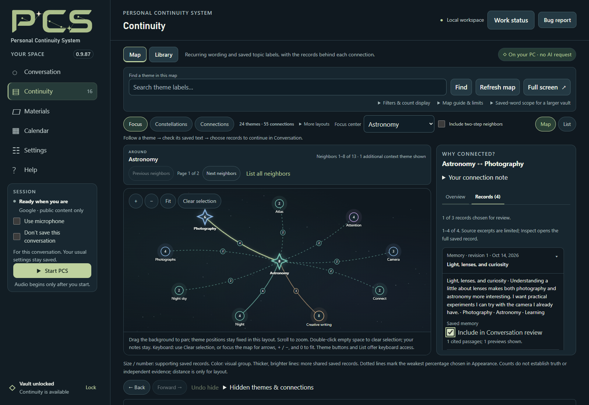

# PCS — Your personal thinking space

**Room to think. Space to connect.**

Some thoughts need more than one conversation. PCS brings AI conversation, revisable memory, reading, notes and planning into a workspace you own. Explore a question, work through a difficult passage, keep an idea for later, or return to a project with the context you chose to save.

**Change the AI. Keep your continuity.** Use a supported Local, Google, OpenAI or Meta connection while your saved conversations, memories and notebooks stay in PCS. Each model brings its own abilities; your workspace belongs to you.

**[Download for Windows][releases]** · [Release notes][releases] · [Website][website] · [Discord][discord] · [Report a bug][issues]

> **PCS 0.9.87 · Pre-release · Windows x64**  
> Free and open source, with no PCS subscription or paid feature tiers. Cloud API usage is billed separately by the services you choose. Local models, AI runtimes and optional speech packs are separate downloads.

*Astronomy, photography, and a story taking shape. This fictional workspace in PCS 0.9.87 shows the saved words behind a connection—and lets you choose what to carry into your next conversation.*

**A place to work through things.** Start with conversation, then add the tools that help you continue.

| When you want to… | PCS gives you… |
| --- | --- |
| Think something through | Typed or spoken conversation, editable Companion direction and a choice of conversation pace. |
| Return to an earlier thread | Saved conversations and revisable memories, with source inspection, corrections and permitted recall. |
| Find a place to resume | A local welcome briefing with saved threads, open kept notes, your reading desk and upcoming Calendar plans. |
| Keep an unfinished thought | An encrypted Keep for later shelf; Continue prepares an editable draft for you to send. |
| Build on something you kept | Reviewed quotations in a Notebook or lesson, or a new Calendar task, goal or event. |
| Read and learn | Materials readers, Web snapshots, bookmarks, Read Along, reading notes, lessons and recorded Practice. |
| Find connections | A Continuity Map with Focus, Constellations, Connections and the saved records behind them. |
| Find your saved work | Library search across saved content, including lesson text and retained quotations, with routes back to the owning feature. |

Manual reading, notes, Calendar entries and saved-record browsing work without starting an AI conversation. You can build up your workspace at your own pace.

**Memory you can inspect and revise.** Saving conversation text and allowing memory formation are separate choices. With learning enabled, PCS can create model-written accounts linked to original passages. Inspect the evidence, review earlier wording, correct an account in ordinary language or choose Forget. Your words, your corrections and model interpretations remain distinguishable.

Recall uses the sharing permissions you enable, and relevant corrections stay attached to the recalled material. Optional Search by meaning uses a separate local search model. Saved accounts can still be incomplete or mistaken; inspect and revise what matters to you.

For a gentle beginning, **Build my starting map** offers six optional opening questions. Preview the prompt, choose what to share, and skip or stop whenever you want. Normal saving and learning choices apply when you send it.

**Come back with a place to begin.** Choose **Refresh briefing** on the welcome screen to inspect saved threads, continue an open kept note, open a local document or review an upcoming Calendar item. The briefing reads current saved records locally, without asking an AI to summarize them. Continue uses the full saved note and the usual draft review; it does not send a message for you.

**Keep a thought, then decide what to do with it.** Review a note or suggestion before keeping it. Later, continue it in Conversation, mark it resolved, reopen it or remove it. Adding a quotation to a Notebook, lesson or Calendar entry preserves the original wording and authorship separately from your own framing. Quotations are local display/export content; your framing follows the destination's normal sharing settings. These actions do not schedule automatic follow-ups or reminder delivery.

**Explore the records behind a connection.** The Continuity Map lets you follow a theme, compare groups, inspect supporting records and prepare a reviewed conversation draft. Saved views, Back and Forward, and your own connection notes help you return to a line of thought. Search from Map opens Library, where you can follow the result back to its source.

Map labels and counts describe saved material. They do not establish truth, personality traits or causes. You can inspect the wording behind a connection and decide what it means to you.

**Read, discuss and learn.** Materials supports readable PDFs, EPUBs, Office and OpenDocument files, tables, slides, subtitles, HTML and common text/code formats. Search a passage, keep a bookmark, listen through an available local voice, or review an excerpt before discussing it with your selected model. Resume reading brings retained positions together while keeping their source versions clear.

Notebooks hold your notes, goals, lessons and source references. Practice can retain submitted answers and assessments when you enable it. Optional research can find public evidence and prepare study notes. Prepared reading notes and retained research notes remain distinct; conversation access to prepared notes requires their unchanged original source to be available. Scanned documents need OCR elsewhere, and some Web pages cannot be captured. Extraction notices explain omissions; model-generated explanations and assessments need review.

**Bring a piece of text into the conversation.** Attach or drop a UTF-8 `.txt` or `.md` file, review the complete text, then choose **Use in this chat**, **Keep for later**, or **Save reviewed text in Materials**. Existing drafts are protected, and oversized actions explain their limits instead of silently shortening the text. Saving in Materials requires PCS to be stopped and creates an ordinary local file outside the encrypted vault. Back it up separately; importing does not automatically share it with a provider or prepare reading notes.

**Choose how much initiative you want.** Conversation pace offers **Follow my lead**, **Think with me** and **Take the lead**. Quiet and Stay here pause topic planning until you explicitly resume. Companion instructions are editable, and reply quality depends on your chosen model.

Local also has an experimental, session-only option for a brief contribution during a quiet moment. It starts off, requires Take the lead and an eligible idle Conversation page, and cannot use tools or save the contribution as a source. Typing, leaving the page, Quiet, Stay here and Stop revoke pending openings. Preparing an idea can add processing time. This option is available only with Local.

Optional **Jev** uses TypeSafe to choose among ideas proposed by your conversation model. It starts off, requires its own key and a sharing review, and adds a cloud request. Local use requires separate cloud consent. Jev does not independently browse your vault or write the reply, and it does not guarantee a better conversation. Optional screen help and tutoring have their own setup and permissions too.

**Choose where the AI runs.**

| Connection | What you need |
| --- | --- |
| **Local on this PC** | Compatible hardware, a supported model and verified runtime. The recommended Gemma/CUDA setup needs a compatible NVIDIA GPU. Experimental Custom GGUF setups have their own compatibility checks. |
| **Google or OpenAI** | Your provider API key and access to a compatible model. Supported routes include cloud audio as well as text. API usage is separate from consumer chat subscriptions. |
| **Meta** | Your Meta API key and account access. Typed conversation needs no local language model or speech pack. Voice uses local transcription and Windows or Kokoro speech. |
| **Experimental Alibaba Qwen** | Its region/workspace setup and API key. This route is voice-only and has a smaller feature set. |

Conversation, memory processing and reading preparation can use separate supported providers. Google, OpenAI and Meta also support notebook drafts and research through their supported models and tools. Optional helper keys can be configured separately; switching providers does not silently reuse another provider's key. Meta does not supply native speech-to-speech or vector embeddings in PCS.

Local conversation and memory have no cloud AI fallback. For offline use, download the required components first, use Local for the roles you need, and leave online tools and cloud preparation off. Brave lookup sends public queries and page requests outside your computer; Local + Jev and cloud preparation send their separately approved inputs to their stated providers.

Typed Local conversation needs no listening pack. Optional English microphone input, Windows or Kokoro speech, local semantic search and compatible OBS vision can be added separately. Saved connections let you switch setups while stopped. Windows Radeon Vulkan text and Ubuntu browser/cloud operation remain experimental previews; macOS is not included.

**Start with one short conversation.**

1. Open [Releases][releases] and download **PCS-0.9.87-Windows-x64.zip**. Extract the complete ZIP into a fresh writable folder.
2. Open **Start PCS.exe**. The first launch prepares its bundled Python environment offline; no system Python installation is needed.
3. For a new workspace, use **Quick Setup** to create your vault and choose a connection. Keep the passphrase safe. **Existing users: restore an encrypted backup before creating a new vault.**
4. Enter your Google, OpenAI or Meta API key, or follow **Local model & files** to install the required Local components. Review your saving and sharing choices. **Settings → Connections** remains available for full setup.
5. In a new setup, microphone use starts off. Once setup is complete and the vault is unlocked, type a short message and choose **Start & send**. Add voice, Materials sharing, Vision and optional tools after that works. Experimental Qwen requires voice instead.

The package includes `START_HERE.md`, a full Getting started guide and searchable offline Help. Keep the application files together: the launcher verifies the package manifest. Use **Quit PCS** when finished; closing the browser tab alone can leave the application running.

**Your data and your sharing choices.**

- Saved continuity lives in your local encrypted vault. Original Materials files, imported text copies and readable exports are outside that encryption.
- Cloud features receive the information allowed by their controls. **Don't save** controls PCS retention; it does not prevent the selected provider from receiving the conversation.
- Corrections and forgetting affect PCS records and dependent saved work. They cannot retract information already disclosed or erase earlier backups.
- Keep your vault passphrase safe. PCS cannot recover it. Changing it affects the working vault; existing backups keep their original passphrases.
- Stop ends the connection, Lock closes vault access, and Quit PCS shuts down the application. They are separate controls.

Before upgrading, save an encrypted backup, copy original Materials separately and quit PCS. Extract the update into a fresh folder, open **Start PCS.exe**, and choose **Restore an encrypted backup instead** before creating a vault. Check the backup, review its counts and restore it. Reconnect unchanged Materials under `data/Materials`, preserve their filenames and subfolders, and use **Materials → Documents → Refresh list** while stopped. Choose your automatic-backup destination again after restoring. Keep your previous installation and pre-upgrade backup until you have checked the restored copy. Never run two copies against the same data folder.

Newly saved features can require a newer reader. Some Meta conversation data and larger combined draft recovery require **0.9.80+**; newer Meta helper settings, credentials and visual provenance can require **0.9.81+**. Earlier feature requirements still apply. Opening or browsing alone does not add these requirements. **Check backup** reports the minimum reader, and Help includes the full compatibility table.

Automatic backups retain the newest copy from each of the 14 most recent days and eight most recent weeks. They run when enabled, with PCS open, its browser page connected, the vault unlocked and the conversation stopped. They pause during **Don't save**. Copy a backup elsewhere to retain it beyond that window; manual and protected backups are excluded from automatic pruning.

**What's new in 0.9.87?** The first public update since 0.9.78 adds Meta across PCS, Quick Setup, the local welcome briefing and reviewed text attachments. It also improves recall and save-result handling, connects more saved content to Library and Map, repairs draft and recovery paths, and fixes the Screen offers layout. The [release notes][releases] cover the full update.

**Help, feedback and development.** PCS is under active development. AI replies, memories, transcription and research can be wrong. The final 0.9.87 package passed **12,766 Python tests** and **2,958 JavaScript tests**, with six Python skips due to platform or environment requirements, plus offline installation, browser, Windows lifecycle and file-integrity checks. These checks used fictional data and injected providers; they do not establish live-provider quality, personal-vault migration, physical-device behavior or long-session reliability.

Use [GitHub Issues][issues] or [Discord][discord] for feedback. Include your version, connection, steps and expected result. Review diagnostics before sharing; exclude keys, passphrases, launch tokens and personal records.

This repository hosts project information and release downloads. Developers should choose **PCS-0.9.87-Source.zip** from the release assets, which includes the application source, tests and build support. GitHub's automatic **Source code** archive contains this download repository. The release also provides **PCS-0.9.87-SHA256SUMS.txt** for archive verification.

PCS first-party code is licensed under **GPL-3.0-only**, without warranty. See [LICENSE][license], [COPYRIGHT][copyright] and [third-party notices][third-party]. Optional contributions through [Ko-fi][kofi] help support development; provider charges remain separate.

[releases]: https://github.com/PCS-PersonalContinuitySystem/PCS/releases
[website]: https://pcs-personalcontinuitysystem.github.io/PCS-site/
[discord]: https://discord.com/invite/2ssCQhNgAN
[issues]: https://github.com/PCS-PersonalContinuitySystem/PCS/issues
[license]: https://github.com/PCS-PersonalContinuitySystem/PCS/blob/main/LICENSE
[copyright]: https://github.com/PCS-PersonalContinuitySystem/PCS/blob/main/COPYRIGHT
[third-party]: https://github.com/PCS-PersonalContinuitySystem/PCS/blob/main/THIRD_PARTY.md
[kofi]: https://ko-fi.com/pcssupport
