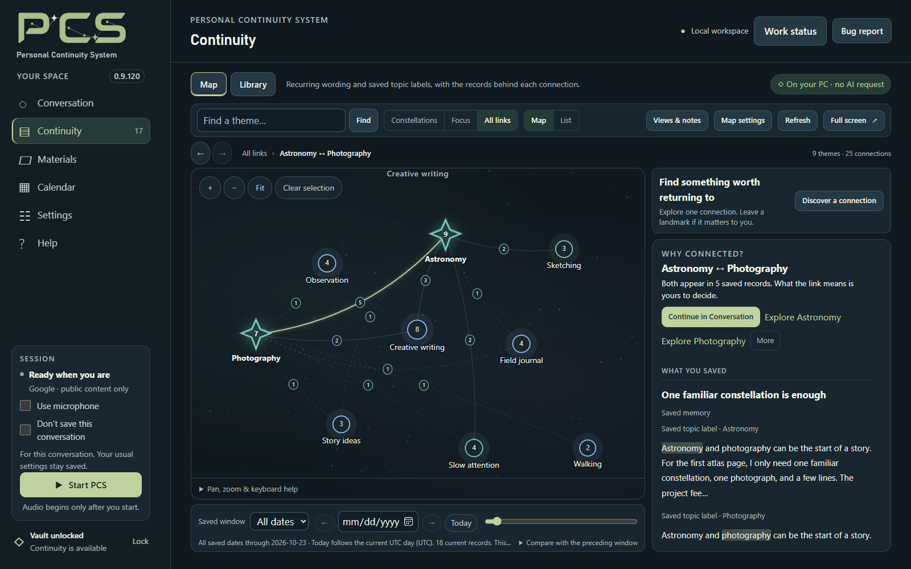

# PCS - Your personal thinking space

**Room to think. Space to connect.**

Some thoughts need more than one conversation. PCS brings AI conversation, revisable memory, reading, notes and planning into a workspace you own. Bring an unfinished question, a difficult passage or an idea. Work on it, keep where you stopped, and return with a place to begin.

**Change the AI. Keep your continuity.** Choose a supported Local, Google, OpenAI, Meta, Claude or signed-in ChatGPT connection. Your saved conversations, memories and notebooks stay in PCS when you change connections. Each model brings its own abilities; your workspace belongs to you.

**[Download for Windows][windows]** · [What's new][release] · [Website][website] · [Discord][discord] · [Report a bug][issues]

**Linux and Mac:** [Experimental Linux x64][linux-experimental] · [Experimental macOS for Apple silicon][mac-experimental] · [Previous release page and source downloads][older-platforms]

> **PCS 0.9.121 · Windows x64 · Under active development**
>
> Free and open source, with no PCS subscription or paid feature tiers. Provider API charges and any subscription used for ChatGPT sign-in are separate. Local models, AI runtimes and optional speech packs are separate downloads.

*One unfinished project, several ways back in. PCS 0.9.120 with fictional demonstration data in the actual app interface; not a live AI conversation. The Map runs locally without a model request.*

## A place to work through things

| When you want to… | PCS gives you… |
| --- | --- |
| Think something through | Typed or spoken conversation, editable Companion direction and a choice of conversation pace. |
| Pick up an unfinished thought | An encrypted Keep shelf with stopping points, next steps and pins, plus an editable draft when you return. |
| Understand what was remembered | Saved conversations and revisable memories, with original passages, corrections and sharing controls. |
| Follow how an idea changed | Links between exact memory revisions, settled marks and named lessons with supporting stories. |
| Find an unexpected connection | A Continuity Map of saved topics, with the records behind each connection and space for your own notes. |
| Read and learn | Materials readers, bookmarks, Read Along, Prepared Notes, notebooks and Practice. |
| Find your work and plan ahead | A searchable Library and Calendar tasks, goals and events. |

Manual reading, notes, Calendar entries and saved-record browsing work without starting an AI conversation.

## Get started

### Windows

1. Download **[PCS-0.9.121-Windows-x64.zip][windows]** and extract the complete ZIP into a fresh writable folder.
2. Open **Start PCS.exe**. First launch prepares the bundled Python environment offline; no system Python installation is needed.
3. Use **Quick Setup** to create your encrypted vault and choose a connection. Keep the passphrase safe. **Existing users: restore an encrypted backup before creating a new vault.**
4. Review what you want to save and share. Quick Setup includes a **Conversation only** option. For **Claude API** or **Sign in with ChatGPT**, unlock the vault and open **Settings → Connections**. Local setup is under **Local model & files**.
5. Type a message and choose **Start & send**. Microphone use starts off in a new setup. Add voice and other optional tools when you want them; experimental Qwen requires voice.
6. At a useful stopping point, choose **Keep a stopping point** and review what you want to retain.

The download includes getting-started and restore guides, plus searchable offline Help. Keep the application files together: the launcher checks the package manifest. Use **Quit PCS** when finished; closing the browser tab alone can leave the application running.

### Linux and Mac (experimental)

Experimental builds are available on the **[previous release page, tagged 0.9.114][older-platforms]**:

| Platform | Download |
| --- | --- |
| **Linux x64** | [PCS 0.9.115 - experimental build][linux-experimental] (`.tar.gz`) |
| **macOS - Apple silicon (arm64)** | [PCS 0.9.114 - Experimental 1][mac-experimental] (`.zip`) |

These are earlier experimental versions and do not include all changes in the current Windows release. Follow their included platform-specific setup instructions. Matching source archives are on the same [release page][older-platforms].

## Bring one unfinished thing

Start with a question, decision, passage or idea that matters to you. For example: *“I keep collecting ideas for this project. Help me choose one small thing to try next.”*

Choose **Follow my lead**, **Think with me** or **Take the lead**. Think with me is guided to develop one manageable thought at a time and leave room for your response. **Quiet for now** and **Stay here** pause topic planning until you explicitly resume. Companion instructions are editable.

If you prefer a broader start, **Build my starting map** offers six optional opening questions. Preview the prompt, choose what to share, and skip or stop whenever you want. Your saving and learning choices still apply.

### Leave a stopping point

Keep a title, where you stopped and an optional next step. Review the note before saving it to the encrypted Keep shelf. Pin it, edit it, mark it resolved, reopen it or delete it when you choose.

On a later visit, unlock your vault and choose **Load saved threads**. Review the suggested stopping point and its sources, then choose **Review & continue** to prepare an editable draft. You decide whether to send it. Loading the return card reads local records without a model request, and existing unsent text is protected.

A resumed thought stays available across Conversation, Materials, Continuity and Calendar. **Explore in Map** carries it into the Map as a temporary reminder.

## Follow a connection back to your own words

The **Continuity Map** opens on **Constellations**, with readable labels based on saved topics. Follow a theme into **Focus**, explore **All links**, or use **List**. The trail above the Map lets you revisit earlier steps.

- **Open the evidence.** Select a connection to inspect the saved records behind it in one panel.
- **Compare two themes.** **Compare with…** shows a route through shared records and themes.
- **Keep what matters.** Add a connection note, leave a landmark in your own words, or choose **Continue in Conversation**.
- **Explore at your own pace.** Try **Discover a connection**, or browse freely. Filters and coverage are under **Map settings**; saved views and connection notes are under **Views & notes**.

Themes use **saved labels** by default, preserving phrases such as “Bread making.” Optional modes include wording from records. Newly formed memories can carry topic labels; existing memories are not rewritten. Monthly save patterns show when themes have been saved or edited more often.

The Map runs on your PC without calling a model. A line means two themes occur in the same saved record. It does not establish agreement, cause or a personality trait. Open the evidence and decide what the connection means to you.

Whole-archive indexing supports up to **50,000 memories** and **250 themes**. The encrypted index follows saves, corrections and forgetting. If you already use it, choose **Map settings → Coverage → Finish indexing** after upgrading to refresh it locally.

## Memory you can inspect and revise

Saving conversation text and allowing memory formation are separate choices. With learning enabled, PCS can create model-written accounts linked to original passages. Inspect the evidence, review earlier wording, correct an account in ordinary language or choose **Forget**. Your words, your corrections and model interpretations remain distinguishable.

Recall follows your sharing permissions and keeps relevant corrections attached. Local checks whether a question needs saved context before replying. A blocked or failed lookup is distinguished from a completed search with no match. Memories and AI answers can still be incomplete or mistaken.

Open a memory and choose **Settled, links & lessons** to:

- Link memories to record how one idea developed from another.
- Mark an exact revision settled as your current word on its subject. A correction retires the mark until you review the new wording.
- Keep a named lesson with your story, takeaway and supporting memories.

Links and lessons retain the revisions you reviewed and identify changed or unavailable references. Forgetting a memory removes its revisions and updates dependent records.

**Claude and signed-in ChatGPT now support personal-memory learning, Remember requests and recall.** Under **Settings → Memory & sharing**, choose **Follow conversation** or select either provider explicitly. Existing sharing choices still control what reaches that connection.

**Help notice relevant memories in conversation** is included in **Recommended continuity** and can be changed under **Settings → Memory & sharing**. It requires memory-sharing permission. Supported routes can use a compact overview or matching cues to help find saved context. A cue sent to a cloud provider shares that information; hints do not guarantee a relevant memory will be found.

## Read, discuss and learn

**Materials** supports readable PDFs, EPUBs, Office and OpenDocument files, tables, slides, subtitles, HTML and common text/code formats. Find a passage, keep a bookmark, listen through an available local voice, or review an excerpt before sharing it with your selected model.

**Prepared Notes** support longer reading projects. **Prepare book** works through an explicitly approved sequence and saves checkpoints; **Resume** lets you review the next scope. Notebooks hold notes, goals, lessons and source references. Practice can retain submitted answers and assessments when enabled.

You can also attach or drop a UTF-8 `.txt` or `.md` file and review it before choosing **Use in this chat**, **Keep for later**, or **Save reviewed text in Materials**. A Materials copy is an ordinary file outside the encrypted vault; back it up separately. Scanned documents need OCR elsewhere, and some Web pages cannot be captured.

Reviewed quotations can be added to a Notebook, lesson or Calendar entry while preserving their wording and authorship. Keeping a thought or creating a Calendar entry does not schedule automatic follow-ups or reminder delivery.

Optional **Explore connections** in the Library lets you select records, add a question and review which excerpts may be shared with Jev. This trial requires a TypeSafe key and permission for each request. Its suggestions do not automatically create memories or change the Map.

## Choose where the AI runs

| Connection | What you need and what to expect |
| --- | --- |
| **Local on this PC** | Compatible hardware, a supported model and verified runtime. Recommended Gemma/CUDA setup needs a compatible NVIDIA GPU; experimental Custom GGUF setups have their own checks. |
| **Google or OpenAI API** | Your provider API key and access to a compatible model. Supported routes include cloud audio as well as text. API billing is separate from consumer chat subscriptions. |
| **Meta** | Your Meta API key and account access. Typed conversation needs no local language model or speech pack; voice uses local listening and speech. |
| **Claude API** | Your Anthropic API key and a compatible model. Typed conversation, permitted PCS tools, personal memory and optional local listening and speech. |
| **Sign in with ChatGPT** | An eligible signed-in account and an available model, subject to account access and usage limits. Typed conversation, permitted PCS tools, personal memory and optional local listening and speech. |
| **Experimental Alibaba Qwen** | Its region/workspace setup and API key. Voice-only, with a smaller feature set. |

**ChatGPT sign-in is separate from the OpenAI API connection.** It does not import ChatGPT history, provide unlimited usage or silently fall back to API billing.

Claude and ChatGPT do not support picture sharing or Web/Study research in this build. Materials preparation and outline drafting still require an explicitly selected **Google, OpenAI, Meta or Local** helper. Unsupported Vision and Research choices turn off when you select a connection that cannot use them; returning to a supported connection does not turn those permissions back on.

Local conversation and memory have no cloud AI fallback. For offline use, download the required components first, use Local for the roles you need, and leave online tools and cloud preparation off. Separately enabled Brave lookup sends public queries and page requests; Local + Jev shares separately reviewed conversation information with TypeSafe; Library exploration shares its approved excerpts.

### Local context and voices

Recommended Local on NVIDIA CUDA defaults to a **128K context window**, with selectable windows up to **256K**. Hardware, model and enabled features determine capacity and speed. Long Local sessions compact working context while retaining recent complete exchanges; saved originals remain unchanged.

Typed Local conversation needs no listening pack. Optional English microphone input, Windows or Kokoro speech, local semantic search and compatible OBS Vision can be added separately.

**Kokoro remains the recommended local voice for everyday use.** Meta, Claude and ChatGPT can also try **KittenTTS 2 on CPU or NVIDIA GPU**, both experimental. Settings offers verified runtime and model downloads and a timed voice sample. Kitten is substantially heavier than Kokoro, and CPU generation can be slow. Review its model license before downloading. **Powered by KittenML.** Local AI conversations continue to use Windows or Kokoro voices.

The current 0.9.121 download is Windows x64. For Linux and Mac, use the experimental downloads listed under **Get started** above.

## What's new since 0.9.114?

- **New in 0.9.121:** automatic memory processing retries eligible temporary provider failures during a conversation, with cooldowns and the existing processing schedule. Each attempt rechecks current saving and sharing permissions.
- **New in 0.9.121:** recovery for indexing later memory batches after a temporary search-embedding failure, more accurate provider error handling and clearer saving-status messages. Earlier missing search vectors still use **Rebuild memory search**.
- Claude and ChatGPT connections, including personal-memory learning and recall through the selected connection.
- A redesigned Map with labeled Constellations, navigation trails, theme comparisons and a single evidence panel.
- Saved topic labels by default, clearer monthly save patterns and repairs for long labels and record bodies.
- Clearer connection presets and sign-in guidance, masked account labels, actionable model-list errors and automatic disabling of unsupported controls.
- Optional experimental Kitten CPU/GPU speech with managed downloads, plus speech startup and cancellation repairs.
- Repairs to Local memory recall after pending saves and reduced repeated processing of saved-area summaries.

See the **[0.9.121 release notes][release]** for details and upgrade guidance.

## Your data and sharing choices

- Saved continuity lives in your local encrypted vault. Original Materials files, imported text copies and readable exports are outside that encryption.
- Cloud features receive information allowed by their controls. **Don't save** controls PCS retention; it does not prevent your selected provider from receiving the conversation.
- Corrections and forgetting affect PCS records and dependent saved work. They cannot retract information already disclosed or erase earlier backups.
- PCS cannot recover a lost vault passphrase. Changing it affects the working vault; existing backups keep their original passphrases.
- **Stop**, **Lock** and **Quit PCS** have separate purposes: end the connection, close vault access, or shut down the application.

## Upgrading and backups

Create an encrypted vault backup, copy original Materials files separately, and quit PCS. Extract the update into a fresh folder. Open **Start PCS.exe** and choose **Restore an encrypted backup instead** before creating a vault. Check the backup, review its counts and restore it. Follow the included restore guide to reconnect Materials and choose your automatic-backup destination again.

Keep your previous installation and pre-upgrade backup until you have checked the restored copy. Never run two copies against the same data folder.

**Some saved features raise the vault's minimum reader version.** New correction metadata and Claude/ChatGPT configuration can require **0.9.117 or newer**. Saving Kitten CPU as a voice requires **0.9.120 or newer**; downloading its packs alone does not. Earlier feature requirements still apply. **Check backup** reports the required reader, and Help includes the compatibility table.

If upgrading an older proactive-help setup, complete the one-time review through **Review model and inputs → Allow → Save settings**. Other feature permissions remain separate.

## Feedback, source and license

PCS is under active development. AI replies, memories, transcription and research can be wrong. Share feedback through [GitHub Issues][issues] or [Discord][discord]. Include your PCS version, connection and reproduction steps. Review diagnostics before sharing and remove keys, passphrases, launch tokens and personal records.

This repository hosts project information and downloads. **[PCS-0.9.121-Source.zip][source]** contains the application source, tests and build support. GitHub's automatic **Source code** archive contains this download repository.

Use **[PCS-0.9.121-SHA256SUMS.txt][checksums]** to verify the release archives. Earlier versions are under [Releases][releases].

PCS first-party code is licensed under **GPL-3.0-only**, without warranty. Third-party components retain their own terms. See [LICENSE][license], [COPYRIGHT][copyright] and [third-party notices][third-party]. Optional contributions through [Ko-fi][kofi] help support development.

[windows]: https://github.com/PCS-PersonalContinuitySystem/PCS/releases/download/v0.9.121/PCS-0.9.121-Windows-x64.zip
[source]: https://github.com/PCS-PersonalContinuitySystem/PCS/releases/download/v0.9.121/PCS-0.9.121-Source.zip
[checksums]: https://github.com/PCS-PersonalContinuitySystem/PCS/releases/download/v0.9.121/PCS-0.9.121-SHA256SUMS.txt
[release]: https://github.com/PCS-PersonalContinuitySystem/PCS/releases/tag/v0.9.121
[releases]: https://github.com/PCS-PersonalContinuitySystem/PCS/releases
[older-platforms]: https://github.com/PCS-PersonalContinuitySystem/PCS/releases/tag/v0.9.114
[linux-experimental]: https://github.com/PCS-PersonalContinuitySystem/PCS/releases/download/v0.9.114/PCS-0.9.115-Linux-x64-Experimental.tar.gz
[mac-experimental]: https://github.com/PCS-PersonalContinuitySystem/PCS/releases/download/v0.9.114/PCS-0.9.114-macOS-arm64-Experimental-1.zip
[website]: https://pcs-personalcontinuitysystem.github.io/PCS-site/
[discord]: https://discord.com/invite/2ssCQhNgAN
[issues]: https://github.com/PCS-PersonalContinuitySystem/PCS/issues
[license]: https://github.com/PCS-PersonalContinuitySystem/PCS/blob/main/LICENSE
[copyright]: https://github.com/PCS-PersonalContinuitySystem/PCS/blob/main/COPYRIGHT
[third-party]: https://github.com/PCS-PersonalContinuitySystem/PCS/blob/main/THIRD_PARTY.md
[kofi]: https://ko-fi.com/pcssupport
