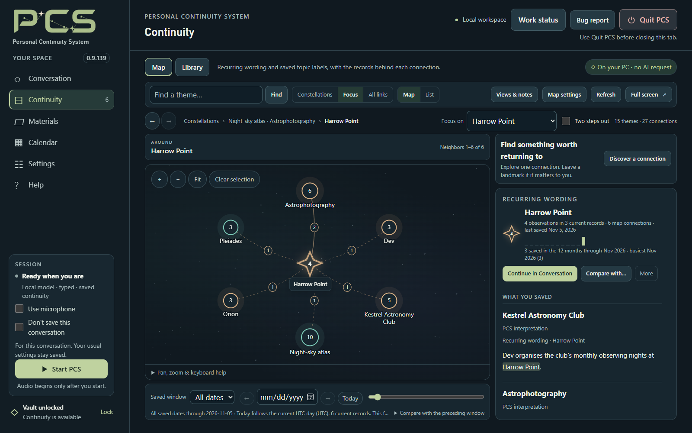

# PCS - Your personal thinking space

**Room to think. Space to connect.**

Some thoughts need more than one conversation. PCS brings AI conversation, revisable memory, reading, notes and planning into a workspace you own. Bring an unfinished question, a difficult passage or an idea. Work on it, keep where you stopped, and return with a place to begin.

**Change the AI. Keep your continuity.** Choose a supported Local, Google, OpenAI, Meta, Claude or signed-in ChatGPT connection. Your saved conversations, memories and notebooks stay in PCS when you change connections. Each model brings its own abilities; your workspace belongs to you.

**[Download for Windows][windows]** · [What's new][release] · [Website][website] · [Discord][discord] · [Report a bug][issues]

**Linux and Mac:** [Experimental Linux x64][linux-experimental] · [Experimental macOS for Apple silicon][mac-experimental] · [Previous release page and source downloads][older-platforms]

> **PCS 0.9.146 · Windows x64 · Under active development**
>
> Free and open source, with no PCS subscription or paid feature tiers. Provider API charges and any subscription used for ChatGPT sign-in are separate. Local models, AI runtimes and optional speech packs are separate downloads.

*One place, several ways back in. PCS 0.9.139 in the actual app interface, with fictional demonstration records in the Local memory format; not a live AI conversation. Harrow Point links three saved subjects because it is named in observations from each. The Map runs locally without a model request.*

## A place to work through things

| When you want to… | PCS gives you… |
| --- | --- |
| Think something through | Typed or spoken conversation, editable Companion direction and a choice of conversation pace. |
| Pick up an unfinished thought | An encrypted shelf of stopping points, next steps and pins, plus an editable draft when you return. |
| Understand what was remembered | Saved conversations and revisable memories, with original passages, corrections and sharing controls. |
| Follow how an idea changed | Links between exact memory revisions, settled marks and named lessons with supporting stories. |
| Find an unexpected connection | A Continuity Map of saved topics and the people, places and projects in them, with the records behind each connection and space for your own notes. |
| See how PCS's own view develops | Optional PCS Perspective tracks PCS's interests, reflections and open questions separately from your continuity and makes them available for inspection. |
| Read and learn | Materials readers, bookmarks, Read Along, Prepared notes, notebooks and Practice. |
| Find your work and plan ahead | A searchable Library and Calendar tasks, goals and events. |

Manual reading, notes, Calendar entries and saved-record browsing work without starting an AI conversation.

## Get started

### Windows

1. Download **[PCS-0.9.146-Windows-x64.zip][windows]** (51 MB) and extract the complete ZIP into a fresh writable folder.
2. Open **Start PCS.exe**. First launch prepares the bundled Python environment offline.
3. Choose **Set up PCS**. The guide walks through **Workspace, Connection, Sharing, Voice, Screen and Review**. Keep your vault passphrase safe. If you're moving an existing vault, follow the [upgrade steps below](#upgrading-and-backups).
4. Choose **Recommended continuity** or **Conversation only** and review what you want to save and share. If you choose Claude, enter your Claude Console API key in Quick setup. If you choose ChatGPT, finish Quick setup, then sign in and pick a model in **Settings → Connections**. Set up experimental Qwen in **Connections**.
5. Type a message and choose **Start & send**. The optional **Voice** step guides local voice setup for Meta, Claude, ChatGPT and Local AI. Use **Screen** to connect OBS Studio for Vision.
6. At a useful stopping point, choose **Keep a stopping point** and review what you want to retain.

Not ready to set up? **See a fictional example** on the welcome screen shows PCS with demonstration records, without adding anything to your vault.

The download includes getting-started and restore guides, plus searchable offline Help. A Settings task finder helps you locate controls. Keep the application files together: the launcher checks the package manifest. Use **Quit PCS** when finished; closing the browser tab alone can leave the application running.

### Linux and Mac (experimental)

Experimental builds are available on the **[previous release page, tagged 0.9.114][older-platforms]**:

| Platform | Download |
| --- | --- |
| **Linux x64** | [PCS 0.9.115 - experimental build][linux-experimental] (`.tar.gz`) |
| **macOS - Apple silicon (arm64)** | [PCS 0.9.114 - Experimental 1][mac-experimental] (`.zip`) |

These are earlier experimental versions and do not include all changes in the current Windows release. Follow their included platform-specific setup instructions. Matching source archives are on the same [release page][older-platforms].

## Bring one unfinished thing

Start with a question, decision, passage or idea that matters to you. For example: *“I keep collecting ideas for this project. Help me choose one small thing to try next.”*

Choose **Follow my lead**, **Think with me** or **Take the lead**. Think with me is guided to develop one manageable thought at a time and leave room for your response. **Quiet for now** and **Stay here** pause topic planning until you explicitly resume. Companion instructions are editable.

If you prefer a broader start, **Build my starting map** offers six optional opening questions. Preview the prompt, choose what to share, and skip or stop whenever you want. Your saving and learning choices still apply.

### Leave a stopping point

Keep a title, where you stopped and an optional next step. Review the note before saving it to your encrypted shelf. Pin it, edit it, mark it resolved, reopen it or delete it when you choose.

On a later visit, unlock your vault and choose **Load saved threads**. Review the suggested stopping point and its sources, then choose **Review & continue** to prepare an editable draft. You decide whether to send it. Loading the return card reads local records without a model request, and existing unsent text is protected.

A resumed thought stays available across Conversation, Materials, Continuity and Calendar. **Explore in Map** carries it into the Map as a temporary reminder.

## Follow a connection back to your own words

The **Continuity Map** opens on **Constellations**, with readable labels based on saved topics. Follow a theme into **Focus**, explore **All links**, or use **List**. The trail above the Map lets you revisit earlier steps.

- **Open the evidence.** Select a connection to inspect the saved records behind it in one panel.
- **Compare two themes.** **Compare with…** shows a route through shared records and themes.
- **Keep what matters.** Add a connection note, leave a landmark in your own words, or choose **Continue in Conversation**.
- **Explore at your own pace.** Try **Discover a connection**, or browse freely. Filters and coverage are under **Map settings**; saved views and connection notes are under **Views & notes**.

Themes come from **saved labels and repeated wording** by default, preserving phrases such as “Bread making.” **Saved labels only** is available under **Map settings**. Local memory keeps one account per subject and adds later observations to it, so the Map counts each current observation: a subject you return to often appears larger, and the people, places and projects named in it become linked themes. A name that appears under two subjects connects them. Monthly save patterns show when themes have been saved or edited more often.

The Map runs on your PC without calling a model. A line means two themes occur in the same saved record or observation. It does not establish agreement, cause or a personality trait. Open the evidence and decide what the connection means to you. Names are recognised by their capital letters, so a name written in lowercase is missed.

Whole-archive indexing supports up to **50,000 memories** and **250 themes**. The encrypted index follows saves, corrections and forgetting. If you already use it, choose **Map settings → Coverage → Finish indexing** after upgrading to refresh it locally.

## Memory you can inspect and revise

Saving conversation text and allowing memory formation are separate choices. With learning enabled, PCS can create model-written accounts linked to original passages. Inspect the evidence, review earlier wording, correct an account in ordinary language or choose **Forget**. Your words, your corrections and model interpretations remain distinguishable.

When you ask PCS to remember something, the request gets its own check, and the result card shows whether the save was confirmed, did not succeed or left a record unchanged. Correction screens show that saving your wording and rebuilding semantic search are separate steps; saved corrections keep their history and current status.

Recall follows your sharing permissions and keeps relevant corrections attached. It can bring back the original conversation passages behind a saved account, including the evidence for a correction. Recalled material labels which words were yours, which were the assistant's and which accounts you edited, so the model can tell them apart. Local checks whether a question needs saved context before replying. A blocked or failed lookup is distinguished from a completed search with no match. Memories and AI answers can still be incomplete or mistaken.

Open a memory and choose **Settled, links & lessons** to:

- Link memories to record how one idea developed from another.
- Mark an exact revision settled as your current word on its subject. A correction retires the mark until you review the new wording.
- Keep a named lesson with your story, takeaway and supporting memories.

Links and lessons retain the revisions you reviewed and identify changed or unavailable references. Forgetting a memory removes its revisions and updates dependent records.

**Claude and signed-in ChatGPT support personal-memory learning, Remember requests and recall.** Under **Settings → Memory & sharing**, choose **Follow conversation** or select either provider explicitly. Existing sharing choices still control what reaches that connection.

**Help notice relevant memories in conversation** is included in **Recommended continuity** and can be changed under **Settings → Memory & sharing**. It requires memory-sharing permission. Supported routes can use a compact overview or matching cues to help find saved context. A cue sent to a cloud provider shares that information; hints do not guarantee a relevant memory will be found.

## PCS Perspective (optional)

PCS Perspective keeps PCS's own developing interests, reflections and open questions in a separate space in your encrypted vault. **Recommended continuity** enables PCS Perspective with independent interests for new vaults. You can change that choice in Settings.

- Inspect each record's wording, supporting references, uncertainty, model authorship and revision history.
- Explore how its views relate in a dedicated Perspective Map.
- Carry current perspectives and unfinished inquiries between supported models.
- Optionally allow bounded exploration during an active conversation, with focused thinking pauses that turn the microphone off and offer **Return to conversation**.

Exploration uses the selected Preparation model and can make additional model requests. It does not browse the web or read Materials on its own. These records make a developing perspective inspectable; they do not establish subjective experience.

## Read, discuss and learn

**Materials** supports readable PDFs, EPUBs, Office and OpenDocument files, tables, slides, subtitles, HTML and common text/code formats, with file-format tiles, reading-time estimates and highlighted passage search. Find a passage, keep a bookmark, listen through an available local voice, or review an excerpt before sharing it with your selected model.

**Prepared notes** support longer reading projects. **Prepare book** works through an explicitly approved sequence and saves checkpoints; **Resume** lets you review the next scope. Notebooks hold notes, goals, lessons and source references. Practice can retain submitted answers and assessments when enabled.

You can also attach or drop a UTF-8 `.txt` or `.md` file and review it before choosing **Use in this chat**, **Keep for later**, or **Save reviewed text in Materials**. A Materials copy is an ordinary file outside the encrypted vault; back it up separately. Scanned documents need OCR elsewhere, and some Web pages cannot be captured.

Reviewed quotations can be added to a Notebook, lesson or Calendar entry while preserving their wording and authorship. Keeping a thought or creating a Calendar entry does not schedule automatic follow-ups or reminder delivery.

Optional **Explore connections** in the Library lets you select records, add a question and review which excerpts may be shared with Jev. This trial requires a TypeSafe key and permission for each request. Its suggestions do not automatically create memories or change the Map.

## Choose where the AI runs

| Connection | What you need and what to expect |
| --- | --- |
| **Local on this PC** | Compatible hardware, a supported model and verified runtime. Recommended Gemma/CUDA setup needs a compatible NVIDIA GPU; experimental Custom GGUF setups have their own checks. |
| **Google or OpenAI API** | Your provider API key and access to a compatible model. Supported routes include cloud audio as well as text. API billing is separate from consumer chat subscriptions. |
| **Meta** | Your Meta API key and account access. Typed conversation needs no local language model or speech pack; voice uses local listening and speech. |
| **Claude API** | Your Anthropic API key and a compatible model. Typed conversation, permitted PCS tools, personal memory, Preparation and notebooks, PCS Perspective, image sharing, web lookup and Wikipedia Study, with optional local listening and speech. |
| **Sign in with ChatGPT** | An eligible signed-in account and an available model, subject to account access and usage limits. The same feature set as Claude API, using your signed-in account. |
| **Experimental Alibaba Qwen** | Its region/workspace setup and API key. Voice-only, with a smaller feature set. |

**ChatGPT sign-in is separate from the OpenAI API connection.** It does not import ChatGPT history, provide unlimited usage or silently fall back to API billing. Usage-limit messages distinguish temporary throttling, an exhausted allowance and unavailable usage information.

Feature coverage still varies by route, model and account. Claude, ChatGPT and Meta do not provide semantic-search (embedding) maintenance; text and navigation recall remain available. Unsupported Vision and Research choices turn off when you select a connection that cannot use them; returning to a supported connection does not turn those permissions back on. Preparation, memory review and Perspective exploration can make additional model requests and incur provider charges.

Local conversation and memory have no cloud AI fallback. For offline use, download the required components first, use Local for the roles you need, and leave online tools and cloud preparation off. Separately enabled Brave lookup sends public queries and page requests; Local + Jev shares separately reviewed conversation information with TypeSafe; Library exploration shares its approved excerpts.

### Local context and voices

Recommended Local on NVIDIA CUDA defaults to a **128K context window**, with selectable windows up to **256K**. Hardware, model and enabled features determine capacity and speed. Long Local sessions compact working context while retaining recent complete exchanges; saved originals remain unchanged. Local helpers can also handle Study, saving web material, memory-thread suggestions and supported visual observations.

Typed Local conversation needs no listening pack. Optional English microphone input, Windows or Kokoro speech, local semantic search and compatible OBS Vision can be added separately.

**Kokoro remains the recommended local voice for everyday use.** Meta, Claude and ChatGPT can also try **KittenTTS 2 on CPU or NVIDIA GPU**, both experimental. Settings offers verified runtime and model downloads and a timed voice sample. Kitten is substantially heavier than Kokoro, and CPU generation can be slow. Review its model license before downloading. **Powered by KittenML.** Local AI conversations continue to use Windows or Kokoro voices.

The current 0.9.146 download is Windows x64. For Linux and Mac, use the experimental downloads listed under **Get started** above.

## What's new in 0.9.146?

- **Pictures in conversation.** With online lookups allowed, supported connections can show an attributed public picture from Wikipedia. A configured Brave Search key lets PCS look for a picture when Wikipedia has none. PCS discards the pictures when the conversation stops.
- **Guided setup.** Quick setup now includes Claude and ChatGPT, with steps for local voice and OBS screen sharing. New vaults using **Recommended continuity** start with more optional helpers enabled. Existing vaults keep their saved choices.
- **Sharing across connections.** Permission to share original conversation excerpts and corrected memories carries over when you change providers. The switch notice names the provider that will receive them. You can turn personal memory sharing off in **Settings → Memory & sharing**.
- **Conversation and Windows fixes.** Claude and Meta can read an original passage and continue looking up related evidence. File and folder choosers now use the same Windows dialog throughout PCS.
- **Proactive help removed.** Its tutoring offers were also removed. Vision, PCS Perspective and Read Along remain available.

See the **[0.9.146 release notes][release]** for details and upgrade guidance.

## Your data and sharing choices

- Saved continuity lives in your local encrypted vault. Original Materials files, imported text copies and readable exports are outside that encryption.
- Cloud features receive information allowed by their controls. **Don't save** controls PCS retention; it does not prevent your selected provider from receiving the conversation.
- Corrections and forgetting affect PCS records and dependent saved work. They cannot retract information already disclosed or erase earlier backups.
- PCS cannot recover a lost vault passphrase. Changing it affects the working vault; existing backups keep their original passphrases.
- **Stop**, **Lock** and **Quit PCS** have separate purposes: end the connection, close vault access, or shut down the application.

## Upgrading and backups

Save your work, choose **Quit PCS** and wait for shutdown. Back up the entire stopped data folder, including any custom data directory. Copy original Materials separately if they are stored elsewhere.

Extract the complete Windows ZIP into a fresh writable folder. Follow the included **Backup & restore** guide to copy or restore your existing data, keeping a separate data folder for each installation. Open **Start PCS.exe**, unlock with your existing passphrase and check your records. Keep the previous installation and backup while you check the update.

**Some saved features raise the vault's minimum reader version.** Since 0.9.121, PCS Perspective requires **0.9.122**; native Claude/ChatGPT features and Local research require **0.9.126**; the newer cloud search index requires **0.9.130**; and Claude/ChatGPT memory-thread suggestions require **0.9.134**. Versions 0.9.140 through 0.9.146 add no new requirement. Earlier requirements still apply, such as **0.9.117** for Claude/ChatGPT configuration and **0.9.120** for the Kitten CPU voice. Opening a vault alone does not add them. **Check backup** reports the required reader, and Help includes the compatibility table.

If you used proactive help, **Save settings** clears its old settings. If you also use Jev, it asks for a fresh review.

## Feedback, source and license

PCS is under active development. AI replies, memories, transcription and research can be wrong. Share feedback through [GitHub Issues][issues] or [Discord][discord]. Include your PCS version, connection and reproduction steps. Review diagnostics before sharing and remove keys, passphrases, launch tokens and personal records.

This repository hosts project information and downloads. **[PCS-0.9.146-Source.zip][source]** contains the application source, tests and build support. GitHub's automatic **Source code** archive contains this download repository.

Use **[PCS-0.9.146-SHA256SUMS.txt][checksums]** to verify the release archives. Earlier versions are under [Releases][releases].

PCS first-party code is licensed under **GPL-3.0-only**, without warranty. Third-party components retain their own terms. See [LICENSE][license], [COPYRIGHT][copyright] and [third-party notices][third-party]. Optional contributions through [Ko-fi][kofi] help support development.

[windows]: https://github.com/PCS-PersonalContinuitySystem/PCS/releases/download/v0.9.146/PCS-0.9.146-Windows-x64.zip
[source]: https://github.com/PCS-PersonalContinuitySystem/PCS/releases/download/v0.9.146/PCS-0.9.146-Source.zip
[checksums]: https://github.com/PCS-PersonalContinuitySystem/PCS/releases/download/v0.9.146/PCS-0.9.146-SHA256SUMS.txt
[release]: https://github.com/PCS-PersonalContinuitySystem/PCS/releases/tag/v0.9.146
[releases]: https://github.com/PCS-PersonalContinuitySystem/PCS/releases
[older-platforms]: https://github.com/PCS-PersonalContinuitySystem/PCS/releases/tag/v0.9.114
[linux-experimental]: https://github.com/PCS-PersonalContinuitySystem/PCS/releases/download/v0.9.114/PCS-0.9.115-Linux-x64-Experimental.tar.gz
[mac-experimental]: https://github.com/PCS-PersonalContinuitySystem/PCS/releases/download/v0.9.114/PCS-0.9.114-macOS-arm64-Experimental-1.zip
[website]: https://pcs-personalcontinuitysystem.github.io/PCS-site/
[discord]: https://discord.com/invite/2ssCQhNgAN
[issues]: https://github.com/PCS-PersonalContinuitySystem/PCS/issues
[license]: https://github.com/PCS-PersonalContinuitySystem/PCS/blob/main/LICENSE
[copyright]: https://github.com/PCS-PersonalContinuitySystem/PCS/blob/main/COPYRIGHT
[third-party]: https://github.com/PCS-PersonalContinuitySystem/PCS/blob/main/THIRD_PARTY.md
[kofi]: https://ko-fi.com/pcssupport
